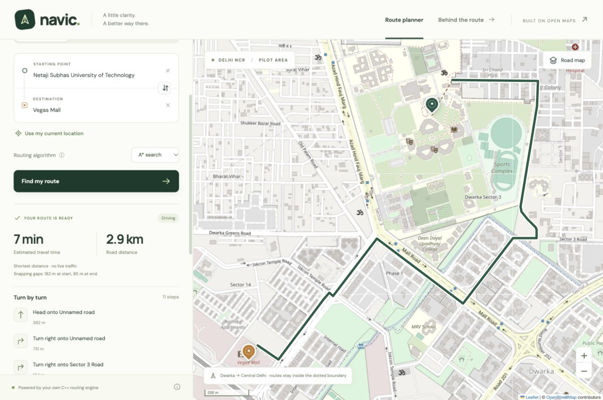

# Navic — a C++ map navigator for Delhi

A B.Tech Electrical Engineering minor project: a real OpenStreetMap graph, custom Dijkstra/A* routing, a C++17 REST API and a React/Leaflet frontend.

**Status:** built and tested locally. Public GitHub/Render/Netlify deployment is prepared but not yet verified. Do not submit a localhost URL as the deployed API deliverable.



## Features
- Search and keyboard autocomplete from a bundled OSM place index.
- Source/destination selection by search, map click or browser geolocation.
- Driving, walking and cycling with mode-specific access/direction masks.
- Dijkstra and A* implemented from scratch; haversine distance heuristic.
- Component-aware nearest-node snapping, GeoJSON route, distance, static ETA and basic maneuvers.
- Local reverse lookup, coverage endpoint, health checks, OpenAPI and Swagger UI.
- Bounded worker pool/cache/rate limiter, input validation and CORS allowlist.
- Offline local demonstration using bundled road geometry instead of downloaded tiles.

**Coverage:** 28.50–28.70° N and 76.98–77.25° E, Dwarka to parts of central Delhi. **Not full Delhi NCR.** The bundled snapshot has 309,697 nodes, 708,631 directed edges and 19,907 named places. Data timestamp: 2026-11-01T19:03:08Z.

## Requirements
For backend: a C++17 compiler (`clang++` or `g++`), POSIX/macOS/Linux environment and Python 3.9+ for data unpacking/tests. CMake is optional; the supplied build script does not require it. For frontend builds: Node 22.12+ (Node 24 used here), and pnpm 11.25.0. No paid key is needed. Docker is an alternative build/deployment path.

On this Mac, clang, Python and Git were present. The frontend was built using the bundled Node runtime; there is no system-wide Node installation. Install Node from its official distribution if you want normal `node`, `npm` and `pnpm` commands in your terminal. The optional local convenience command below locates the already-present runtime as well.

## Quick start
Run from the repository root:
```sh
python3 scripts/unpack_data.py
sh scripts/build.sh
sh scripts/build_frontend.sh
./build/navic-api
```

Open [the local app](http://127.0.0.1:8080) and [interactive API docs](http://127.0.0.1:8080/docs). The C++ server serves both the built frontend and API. Ctrl+C stops it. For development on a standard Node installation:
```sh
cd frontend
pnpm install --frozen-lockfile
pnpm run dev
```
Vite proxies API paths to port 8080. Keep the C++ process running in another terminal. To install the exact pnpm version on a standard Node/npm installation, use `npm install --global pnpm@11.25.0`.

## Configure
Defaults work locally without an `.env`. To customize:
```sh
cp .env.example .env
set -a
. ./.env
set +a
./build/navic-api
```
Read and edit only your own trusted `.env`, since sourcing a shell file executes its contents. The executable reads environment variables; it does not automatically parse `.env`. Origin entries have no spaces/trailing slash. Never commit secrets. A separate frontend deployment sets `VITE_API_BASE_URL` before its build; no private key belongs in a VITE_ variable.

## Use and inspect the API
```sh
curl -s http://127.0.0.1:8080/health
curl -s 'http://127.0.0.1:8080/geocode?q=NSUT&limit=6'
curl -s 'http://127.0.0.1:8080/reverse-geocode?lat=28.6109714&lon=77.037946'
curl -s http://127.0.0.1:8080/route \
  -H 'Content-Type: application/json' \
  -d '{"source":{"lat":28.6109714,"lon":77.037946},"destination":{"lat":28.6010845,"lon":77.0296006},"mode":"driving","algorithm":"astar"}'
```

| Endpoint | Purpose |
|---|---|
| GET /health | Readiness and graph counts |
| GET /coverage | Bounds, modes and provenance |
| GET /geocode | Local name/alias search |
| GET /reverse-geocode | Nearest named feature, approximate |
| POST /route | Shortest-distance route |
| GET /network | Offline road backdrop |
| GET /openapi.json | Machine-readable API contract |
| GET /docs | Interactive Swagger UI |

OpenAPI describes paths, inputs, outputs and errors; Swagger UI renders that specification and can issue real requests. This is hand-authored/generated from `scripts/generate_openapi.py`, not automatically inferred by a Python web framework. Swagger assets use a pinned CDN; offline users can inspect the local JSON specification.

## Test and benchmark
```sh
python3 -m venv .venv
.venv/bin/python -m pip install -r requirements.txt
sh scripts/build.sh
.venv/bin/python -m pytest -q --junitxml=artifacts/pytest-results.xml
python3 scripts/benchmark.py
python3 scripts/smoke_test.py http://127.0.0.1:8080
```
The benchmark/smoke test need a running API; pytest starts and stops its own isolated servers. The C++ suite performs 16,529 assertions, including seeded comparison with an independent Floyd–Warshall oracle. The Python suite contains 45 integration/preparation tests. Results and limitations are in `docs/05-testing.md` and the `artifacts` directory. A sanitizer run and physical-device/geolocation tests should only be claimed if separately recorded.

## Rebuild OSM data
The committed gzip snapshot is sufficient for running the project; no Overpass download is needed at startup. To deliberately update the bounded extract:
```sh
python3 scripts/prepare_data.py --download
```
To rebuild from the cached raw extract:
```sh
python3 scripts/prepare_data.py
```
An alternative bbox is provided as `--bbox SOUTH WEST NORTH EAST`. Larger regions require new resource measurements and coverage tests. This importer uses Python's standard library, not OSMnx/NetworkX; C++ adjacency lists own the production graph. Do not continuously poll a donated Overpass server. The raw download is ignored by Git. `data/metadata.json` contains counts, timestamp and checksum; `unpack_data.py` validates the saved graph.

## Deployment and Git
The [deployment guide](docs/06-deployment.md) covers account connection and the public verification checklist. The [Git guide](docs/08-git.md) covers pushing the project.
Follow `docs/06-deployment.md` for exact account-connection steps, free limits, Render Docker deployment, Netlify configuration and the live smoke-test checklist. Follow `docs/08-git.md` for repository creation and push commands. Source is complete in this directory and the packaged archive; no code snippets require filling in omitted implementation.

## Project map
```text
backend/include/navic/graph.hpp    Graph, geographic math, snapping, algorithms, maneuvers
backend/src/main.cpp              HTTP service, validation, search, caching and limits
backend/tests/test_graph.cpp      Independent routing correctness checks
backend/vendor/                  Pinned C++ headers and MIT notices
frontend/src/                    React UI, Leaflet component, API client and CSS
frontend/public/                 App icon and static assets
frontend/pnpm-lock.yaml           Reproducible frontend dependency lock
data/graph.ndjson.gz              Compressed real OSM graph (tracked)
data/network.geojson              Offline road geometry (tracked)
data/metadata.json                Data version, counts and checksum
scripts/                         Build, data, documentation, benchmark and smoke commands
tests/                           pytest HTTP and data-preparation tests
docs/                            Requirements, architecture, test/deploy guides and viva pack
output/pdf/                      Report and one-page cheat sheet
artifacts/                       Recorded test and benchmark evidence
Dockerfile                       Multi-stage frontend/C++ runtime build
render.yaml                      Free Render web service blueprint
netlify.toml                     Separate static frontend deployment
.github/workflows/ci.yml          Linux build/test workflow (execution requires push)
```
`docs/file-tree.txt` in the source bundle gives the full delivered file inventory.

## Study and defend
Read the [13-page project report](output/pdf/navic-minor-project-report.pdf), [viva guide](docs/viva-guide.md), [60 questions and answers](docs/viva-questions.md), [demo script](docs/demo-script.md) and [one-page revision sheet](output/pdf/navic-viva-cheat-sheet.pdf). See [Phase 7](docs/07-documentation.md) to regenerate the PDFs.
Start with `docs/viva-guide.md`: two-/five-minute walkthroughs, block-by-block source explanations, concept primers, choices and honest weaknesses. Then use `docs/viva-questions.md` (60 answers and follow-ups), `docs/demo-script.md` and `docs/cheat-sheet.md`. An interactive mock viva follows completion of the build/deployment: one question at a time, grading and feedback.

## Limitations and attribution
The app optimizes road distance, not travel time. ETA has no live traffic or signal delay. The routing profile does not implement turn-restriction relations, barriers, conditional rules or all regional access defaults. Node snapping can select a road across an inaccessible gap; shared weak connectivity is necessary but not sufficient for a directed route. Basic instructions are not lane/roundabout-exit guidance. Local search is not a complete address geocoder. This is an educational prototype.

Map/database content is © [OpenStreetMap contributors](https://www.openstreetmap.org/copyright), under ODbL. Derived data follows that license, separately from project code. Follow [OSM tile policy](https://operations.osmfoundation.org/policies/tiles/) and [Nominatim policy](https://operations.osmfoundation.org/policies/nominatim/); the public Nominatim service is not used. Third-party code retains its notices; see `THIRD_PARTY_NOTICES.md`. AI assistance should be acknowledged according to the institution's academic policy.
