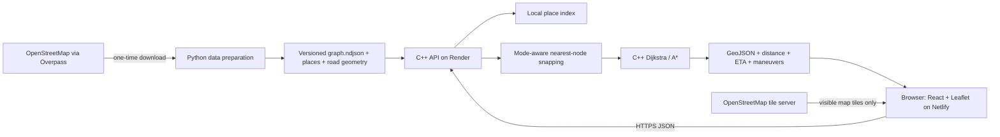

# Phase 2 — architecture



## One request, end to end
1. The user selects search results or clicks the map. UI coordinates are latitude/longitude.
2. React sends POST /route with source, destination, mode and algorithm.
3. C++ checks JSON types, finite coordinate ranges, coverage and mode/algorithm enums.
4. It finds nearby mode-eligible nodes, preferring a shared weak component with minimum combined snapping gaps, and rejects excessive distance. Directed reachability is still determined by the routing algorithm.
5. The algorithm traverses directed edges permitted for the mode. Edge cost is meters.
6. Parent edge IDs reconstruct the exact path, including parallel roads. ETA sums edge time.
7. Geometry bearings and road names yield basic maneuvers. Response uses GeoJSON [longitude, latitude].
8. Leaflet renders the line and markers; React renders road distance, estimated time and directions.

## API contract
All API endpoints return JSON except /docs. Errors use `{ "error": { "code": "...", "message": "..." } }`.

| Method | Path | Purpose | Success |
|---|---|---|---|
| GET | /health | Readiness, graph counts and data version | 200 |
| GET | /coverage | Bounding box, supported modes and metadata | 200 |
| GET | /geocode?q=dwarka&limit=6 | Ranked local place search | 200 |
| GET | /reverse-geocode?lat=28.60&lon=77.04 | Nearest indexed place, not a street-address guarantee | 200 |
| POST | /route | Compute shortest-distance route | 200 |
| GET | /network | Bundled OSM road geometry for offline map backdrop | 200 |
| GET | /openapi.json | OpenAPI 3.0 contract | 200 |
| GET | /docs | Interactive Swagger UI | 200 |

POST /route request:
```json
{"source":{"lat":28.609,"lon":77.040},"destination":{"lat":28.602,"lon":77.025},"mode":"driving","algorithm":"astar"}
```

The response includes `geometry`, `distance_m`, `duration_s`, `steps`, `snapped`, `algorithm`, `mode`, `visited_nodes`, `search_ms`, `cached`, `data_version` and `warnings`. Exact schemas and runnable examples are provided in /openapi.json. Allowed modes: driving, walking, cycling. Allowed algorithms: dijkstra, astar. The optional /alternatives endpoint is deliberately excluded until a real alternative-path algorithm and tests exist.

| Status | Meaning |
|---|---|
| 400 | Malformed JSON or invalid query syntax |
| 403 | Browser Origin is outside the configured CORS allowlist |
| 404 | Unknown endpoint, or no route in the selected mode |
| 413 | Request body exceeds 16 KiB |
| 415 | POST /route is not application/json |
| 422 | Invalid values, out-of-coverage point or no nearby usable node |
| 429 | Rate limit exceeded; Retry-After supplied |
| 500 | Unexpected server failure, details only in server log |

## Design choices
| Choice | Defense | Cost |
|---|---|---|
| C++17 | User preference, explicit data structures, compact runtime | More manual validation and memory/thread awareness |
| cpp-httplib + nlohmann/json | Small, documented libraries with separate HTTP and JSON responsibilities | Blocking handlers; not an async framework |
| Own graph and algorithms | Inspectable and demonstrable in the viva | Must define permissions and limitations honestly |
| A* default | Haversine distance is a lower bound on graph distance | Benefit depends on graph and endpoints |
| Dijkstra comparison | Same objective without heuristic; correctness baseline | Usually explores more nodes |
| Offline data preparation | No network download at API startup | Data refresh is a deliberate rebuild |
| Local gazetteer | Autocomplete and offline demonstrations without keys | Limited names and address coverage |
| React + Leaflet | State-driven UI and mature interactive maps | Build step and client bundle |
| Render Docker | Deploys C++ reproducibly with a prebuilt graph | Free service sleeps and has resource limits |

## Concurrency and data lifetime
The immutable graph is loaded once at process startup. Four HTTP workers share it. A mutex protects the bounded route cache and rate-limit state. Route search arrays are local to each request. No outbound API call is needed to route or search. CORS is browser policy, not authentication. Rate limits use socket peer addresses rather than trusting arbitrary X-Forwarded-For headers; behind a proxy multiple users may share a bucket.

## Run/test and viva note
Read /openapi.json after starting the API, then send a POST with curl. A* uses f(n)=g(n)+h(n), with h(n) equal to the great-circle distance to the target. The builder and loader enforce edge length at least the endpoint great-circle distance, so this heuristic remains admissible for the distance objective.

## Three-line revision
Download OSM once, construct a graph, then serve requests entirely from local data.
Validate → snap → search → reconstruct → describe → draw.
Latitude/longitude objects enter the API; GeoJSON [longitude, latitude] leaves it.
