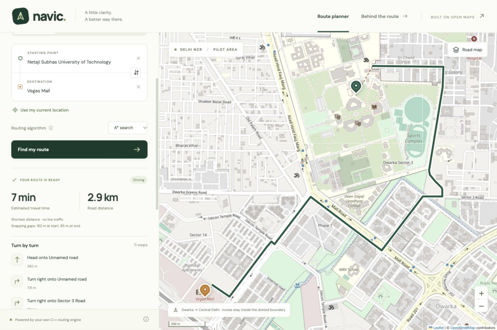
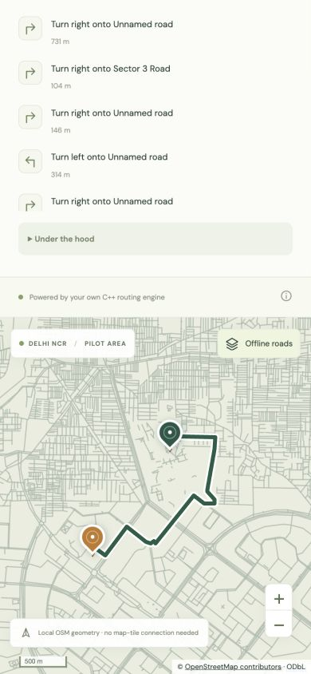

# Navic
## A C++ Map Navigator for a Delhi Pilot Region

**Minor project report · B.Tech Electrical Engineering**

Netaji Subhas University of Technology, Delhi

Prepared: 2 November 2026

**Implementation:** C++17 REST API, React, Leaflet and OpenStreetMap.

**Submission status:** The application and local verification are complete. Public API deployment is prepared but remains pending account connection and a successful public smoke test. This report must be updated with the real deployment URL, deployed commit and cloud results before final submission.

Student identity, roll number, supervisor details and any institution-specific certificate/declaration must be supplied by the student. They have not been invented. AI assistance should be disclosed according to the institution's policy.



**Reading map:** problem and requirements; literature; architecture; data; algorithms; API; interface; testing; results; deployment; limitations; references.

---

# 1. Abstract and problem definition

Navic is an educational map navigator that demonstrates how a real street network becomes a searchable graph and a publicly deployable web API. The browser supports place search, source and destination selection, three travel modes, a route line, road distance, an estimated duration and basic turn instructions. A C++17 server implements Dijkstra and A* directly over adjacency lists built from OpenStreetMap (OSM) data.

The delivered pilot covers latitude 28.50–28.70 north and longitude 76.98–77.25 east, from Dwarka through parts of central Delhi. It contains 309,697 nodes, 708,631 directed edges and 19,907 named places. It is not a full Delhi NCR service. Preprocessing occurs once; the server loads a saved graph and needs no external routing or geocoding key during requests.

Local verification passed 16,529 C++ assertions and 45 Python integration/preparation tests. Both algorithms produced equal shortest-distance costs for the recorded examples. A* explored fewer nodes in these samples. The final data-loading process used approximately 134.1 MiB maximum resident memory on the development Mac. These are local observations, not cloud performance guarantees. A public deployment remains the outstanding college deliverable.

## Objectives
- Implement and explain shortest-path algorithms on a genuine geographical network.
- Expose routing and place lookup through a documented HTTP/JSON interface.
- Provide a responsive browser interface with clear validation and failure states.
- Make correctness, data provenance, measured results and limitations inspectable.
- Deploy the API on a free service and verify it independently of the development computer.

## One-page requirements summary
| Area | Acceptance condition |
|---|---|
| Search | Bundled name/alias autocomplete and approximate reverse lookup |
| Selection | Search, map click, swap and browser location control |
| Routing | Driving/walking/cycling; selectable Dijkstra or A* |
| Output | GeoJSON route, distance, static ETA and basic steps |
| Reliability | Validated inputs, structured errors, bounded resources and tests |
| Delivery | Complete source, deployment configuration, report and viva material |
| Public API | Real HTTPS URL and successful smoke test; currently pending |

Alternative routes, live traffic, voice guidance and full NCR coverage are optional future work. The prototype is intended for demonstration and learning, not authoritative road-safety guidance.

---

# 2. Literature survey and design choices

Dijkstra's 1959 shortest-path method [1] expands the lowest known path cost first and gives optimal paths for nonnegative edge costs. It provides a clear correctness baseline for this project. A* [2] adds an estimate of remaining cost to the priority. With a suitable heuristic, it directs exploration toward the destination while retaining shortest-path correctness.

OSM [3] is an openly licensed geographical database. Its nodes, ways and relations supply road geometry and attributes; the map pictures displayed in a browser are a separate product. Overpass [4] is used to obtain the bounded extract. The OSM tile policy [5] governs the optional online background. The public Nominatim policy prohibits client-side autocomplete [6], so Navic searches its own bundled named-feature index instead.

External engines such as OSRM are an alternative to writing a router. They offer much more mature preprocessing and routing profiles, but treating one as the main engine would hide the algorithm implementation that this viva needs to demonstrate. Navic therefore uses its own graph and algorithms. No external-engine accuracy or speed comparison has been performed, and none is claimed.

| Choice | Reason and trade-off |
|---|---|
| C++17 backend | User preference; explicit data structures and efficient graph storage; more manual API work |
| cpp-httplib + JSON header | Small, inspectable dependencies; less framework automation |
| Python preprocessing | Simple offline parsing and reproducible data conversion; production routing stays in C++ |
| Custom Dijkstra + A* | Makes correctness and heuristic reasoning visible; omits mature routing features |
| React + Leaflet | Interactive component state and map layers; browser build toolchain required |
| Local gazetteer | No paid key, runtime dependency or public-autocomplete policy conflict; incomplete address search |
| Saved regional graph | Predictable startup without downloads; bounded coverage and stale snapshot |
| Same-origin first deployment | One Render service can demonstrate API and UI; independent Netlify hosting remains available |

The earlier Python-backend default was deliberately replaced by C++. OSMnx/NetworkX are not production dependencies: a small Python converter writes a documented graph format, and the C++ implementation owns routing. Walking and cycling use separate permission masks rather than merely changing the driving ETA.

**Pinned build:** cpp-httplib 0.56.0, nlohmann/json 3.12.0, React 19.3.1, Leaflet 1.9.4, Vite 8.3.5 and pnpm 11.25.0. Release/documentation references and licenses are recorded in the repository.

---

# 3. System architecture and request flow

## System diagram
```text
BUILD / DATA PREPARATION
OpenStreetMap -> bounded Overpass extract -> Python converter
                   |                       |
                   v                       v
           cached raw input        graph + places + roads
                                           |
RUNTIME                                    v
Browser React + Leaflet <-> HTTP/JSON <-> C++ API
       |                                    |
       +-> OSM tile server (optional)       +-> immutable graph
       +-> bundled road vectors             +-> Dijkstra / A*

DEPLOYMENT
GitHub source -> Docker build -> Render API + optional same-origin UI
             -> frontend build -> optional Netlify UI -> Render API
```

## One route, end to end
1. The user selects two coordinates, a travel mode and an algorithm. The frontend cancels stale work when these inputs change.
2. The browser sends POST /route as JSON. The server checks origin, request rate, content type, size, coordinate types/ranges, bounds and enum values.
3. Each endpoint is associated with eligible nearby graph nodes. Shared weak road components are preferred within an 800 m maximum snap distance.
4. A cache hit can return an already computed graph route. Otherwise the selected algorithm searches mode-eligible directed edges, storing distances and parent edge IDs.
5. The server reconstructs the path, sums lengths and estimated times, generates basic maneuvers and serializes GeoJSON with coordinate order [longitude, latitude].
6. The frontend draws the route, displays metrics and instructions, and distinguishes snapped-road gaps from the routed path.

## Separation of responsibilities
The data converter interprets the supported subset of OSM tags. The graph library knows graph structure, geometry and search. The HTTP layer manages validation, caching and response contracts. React manages application state while Leaflet manages map drawing. Deployment configuration packages the same source and immutable data used in local verification.

The design allows failures to be identified at the correct boundary: an empty search result is different from an out-of-coverage point, a snap failure, an unreachable directed route or a sleeping host.

---

# 4. Map data and graph construction

## Provenance and representation
The bundled extract has data timestamp **2026-11-01T19:03:08Z**. It comes from OpenStreetMap contributors under ODbL. Metadata records the bounding box, counts, objective, limitation flags and SHA-256 checksum. The compressed graph is committed; raw downloads and the generated uncompressed graph are excluded from Git.

The converter retains consecutive road-shape nodes and creates directed edges. Edge fields include destination index, length, mode mask, per-mode travel time and road naming information. Adjacency lists preserve parallel edges; parent edge IDs later identify the actual chosen edge. This representation is simple to explain and avoids losing curved geometry through overly aggressive simplification.

The NDJSON format consists of a header, node records and edge records. The loader reads it incrementally instead of materializing a second giant JSON document. It validates indices and costs and builds mode-specific weak-component indexes. Data is immutable once startup completes.

## Access and directions
Known highway classes define default mode eligibility. Specific access tags override broader access tags, and supported one-way exceptions affect direction masks. Private, destination-only and customer-only cases are conservatively excluded. Roads represented as areas are not treated as traversable polygon boundaries. OSM's full legal-access semantics are substantially more complicated than this supported subset.

## Snapping place locations to streets
Place locations can be centroids inside campuses or buildings, while routing uses road nodes. For each endpoint, the server finds eligible candidates within 800 m and groups them by weak component. It chooses a common component minimizing the sum of the two snapping gaps, using a source with eligible outgoing edges and a destination with incoming edges.

This improves the demonstration over independently choosing isolated nearest service roads. However, weak connectivity ignores edge directions and cannot guarantee a directed route. The algorithm must still prove reachability. Straight dashed gaps are visual aids; they are not validated walking connectors and are excluded from route distance and ETA.

## Place search and offline geometry
Named nodes, ways and relations provide a local gazetteer. Search ranks exact, prefix, substring and supported alias matches and deduplicates names. Reverse lookup returns the nearest named feature with an explicit approximate flag, not a verified postal address. A simplified road GeoJSON layer provides an offline background without bulk-downloading OSM tiles.

**Reproduction:** `python3 scripts/unpack_data.py` validates and restores the committed snapshot. A deliberate data refresh uses `python3 scripts/prepare_data.py --download`; it changes provenance and requires re-running tests and measurements.

---

# 5. Routing methodology

## Dijkstra
Set the source distance to zero and other distances to infinity. A minimum-priority queue holds candidate nodes. Pop the smallest current distance, ignore obsolete queue entries, and relax each eligible outgoing edge. Relaxation replaces a destination distance when `g(u) + w(u,v)` is smaller. The target is accepted when its current-best queue entry is popped, not when it is first discovered.

## A* and the heuristic
A* uses the same relaxation and reconstruction logic but orders entries by `f = g + h`. Here g is known road distance from the source, and h is the great-circle distance to the target. Both use metres. A distance heuristic must not be added to a time cost without an appropriate conversion and proof.

Haversine estimates the great-circle distance between latitude/longitude positions. With angles in radians:
```text
a = sin²(Δφ/2) + cos(φ1) cos(φ2) sin²(Δλ/2)
d = 2 R asin(sqrt(a))       R = 6,371,008.8 metres
```
The graph loader ensures edge length is at least the endpoint haversine distance. The spherical triangle inequality then gives `h(u) <= w(u,v) + h(v)`, the consistency condition. Also h(target)=0. Removing mode-ineligible edges does not make the lower bound overestimate any remaining path. This is the basis for optimality under the implemented distance model.

## Distance, ETA and instructions
The optimization objective is **shortest road distance**. ETA is computed after selecting that path as the sum of `length / (speed_kmh / 3.6)`. Driving speeds use the converter's supported road-speed model, while walking/cycling use static profiles. Traffic, congestion, signals and stopping delays are not predicted. The shortest route therefore need not be the fastest route.

Reconstructed edges provide a GeoJSON LineString and road names. Heading changes and name transitions generate basic maneuver descriptions. These do not model lane selection, legal turn restrictions or reliable roundabout exit numbers.

## Complexity and verification
Graph storage is O(V+E). With lazy duplicate entries, the heap can contain O(E) entries and the search has worst-case O((V+E) log(E+1)) time; the familiar O((V+E) log V) expression is suitable for sparse road graphs. Search arrays are O(V), while the heap can be O(E). Current snapping scans are O(V). A spatial index is a useful next optimization.

Native tests compare costs and reachability against an independent Floyd–Warshall oracle on seeded small graphs, as well as targeted directed, parallel-edge, same-node, mode and snapping cases. A* returning the same cost as Dijkstra alone would be weaker evidence because both could share an implementation error.

---

# 6. Backend API implementation

The C++ process binds the configured HOST and PORT, loads the graph once, and serves JSON plus the built frontend. Four workers and a bounded queue limit request concurrency. Unexpected errors are logged and converted into structured responses. Logs avoid recording query coordinates and client IPs as application data.

| Method and path | Purpose |
|---|---|
| GET /health | Ready status, version and graph counts |
| GET /coverage | Bounds, supported modes and provenance |
| GET /geocode | Local name search; q and limit parameters |
| GET /reverse-geocode | Approximate nearest named feature |
| POST /route | Source/destination, mode, algorithm to route result |
| GET /network | Bundled offline road geometry |
| GET /openapi.json | Machine-readable contract |
| GET /docs | Swagger UI for interactive requests |

## Complete example request
```json
{
  "source": {"lat": 28.6109714, "lon": 77.037946},
  "destination": {"lat": 28.6010845, "lon": 77.0296006},
  "mode": "driving",
  "algorithm": "astar"
}
```
The response includes geometry, distance_m, duration_s, steps, snapped endpoint information and algorithm statistics. The complete schemas and examples are available in docs/openapi.json. The contract is explicitly generated by scripts/generate_openapi.py; C++ does not automatically infer it from handlers.

## Validation and resource controls
JSON bodies are limited to 16 KiB. Coordinates must be finite numbers, within global coordinate ranges and the pilot bounds. Modes and algorithms are allowlisted. A token bucket defaults to 180 requests/minute per socket peer; its identity map is bounded. Forwarded client headers are not trusted, so clients behind a hosting proxy may share a bucket. This requires observation after deployment.

The route cache holds at most 64 entries and skips individual serialized responses over 64 KiB, bounding cached serialized payloads to about 4 MiB, plus object overhead. It caches graph routes, while request-specific snap information is attached separately. CORS allows exact configured browser origins; it is not authentication or protection against non-browser callers.

**Status codes:** 200 success; 204 preflight; 400 malformed input; 403 disallowed origin; 404 no route; 413 body too large; 415 wrong content type; 422 invalid values, coverage or snapping; 429 rate limit; 500 unexpected failure.

---

# 7. Frontend and user interaction

The React interface combines a route-planning panel with a Leaflet map. Search inputs debounce requests, support keyboard selection and cancel outdated work. Editing an endpoint clears the previous selection and result. Travel-mode or algorithm changes invalidate the existing route so the displayed answer cannot silently belong to old inputs.

Source and destination can be selected through place search, map clicks or the browser's location control. Location access requires the browser's permission and an appropriate secure context. Permission denial and unsupported/unavailable location are handled as user-visible errors; actual personal-location acquisition has not been exercised in this verification session.

## Map and result display
The interface draws endpoint markers, the route line, a coverage boundary and dashed snapping gaps. A result panel shows distance, estimated duration, maneuver count and search statistics. Online OSM tiles are optional: the user can switch to bundled road vectors for a local offline demonstration. WGS84 latitude/longitude is used for data interchange; Leaflet displays the map using its normal Web Mercator map projection.

The UI converts GeoJSON [longitude, latitude] ordering correctly when passing points to Leaflet's [latitude, longitude] APIs. Confusing these orders can place a route in the wrong country even when the graph algorithm is correct.

## Verified browser flows
- Keyboard autocomplete selected NSUT and Vegas Mall and produced a visible route.
- The driving result displayed approximately 2.9 km and 7 minutes.
- Changing to walking cleared the prior result and produced approximately 36 minutes.
- The offline vector layer retained route visibility without requiring map tiles.
- A 390 px viewport used a stacked mobile layout with no horizontal overflow.



The image is a real local browser capture, not a design mockup. Browser screenshots establish UI behavior only; they do not prove public hosting or production routing safety.

---

# 8. Integration and test results

Testing proceeds from graph correctness to the real HTTP boundary and finally browser interaction. pytest launches isolated C++ server processes on temporary ports and cleans them up. Synthetic fixtures isolate failure cases that are difficult to reproduce reliably with changing real-world map data.

| Scenario | Expected | Recorded result |
|---|---|---|
| Random graphs and targeted graph cases | Oracle-equivalent shortest cost/reachability | 16,529 native assertions passed |
| HTTP and preparation suite | Valid responses and correct rejection behavior | 45 pytest tests passed |
| Three modes, both algorithms | Valid real-data routes; equal algorithm costs | Passed |
| Same source and destination | Zero distance and time; valid geometry | Passed |
| Disconnected graph | 404 NO_ROUTE | Passed |
| Outside pilot / excessive snap gap | 422 with specific error | Passed |
| Malformed JSON / bad content type | 400 / 415 | Passed |
| Oversized body | 413 | Passed |
| CORS allowlist and preflight | Exact headers or 403 | Passed |
| Token bucket / forged forwarding header | 429; header cannot bypass limit | Passed |
| Repeated cacheable request | Cached result, no new search work | Passed |
| Production frontend build | Successful static bundle | Passed |
| Desktop/mobile/offline flows | Correct visible interaction | Browser verified |
| Personal device geolocation | Permission and position handling | Not exercised |
| Linux CI and Docker build | Platform build and tests | Pending remote execution |
| Public deployment | HTTPS smoke test from independent device | Pending account connection |

## Evidence and reproduction
The exact test items are in artifacts/pytest-results.xml. Route observations are in artifacts/benchmark.json, local smoke results in artifacts/local-smoke-test.json, and startup memory in artifacts/resource-check.json. docs/05-testing.md expands the expected/actual table and identifies manual checks.

```sh
sh scripts/build.sh
.venv/bin/python -m pytest -q
sh scripts/build_frontend.sh
python3 scripts/benchmark.py
python3 scripts/smoke_test.py http://127.0.0.1:8080
```

The last two commands require a running API. Restart the process before measuring uncached searches. Test counts are not coverage percentages, and a passing local suite is not evidence that an unexecuted container or CI job has passed.

---

# 9. Measured performance and interpretation

Measurements below are from one uncached request per case on the development macOS arm64 machine, with the delivered OSM snapshot. They are observations, not statistical latency percentiles or a concurrent load test. All reported Dijkstra/A* pairs returned equal route costs.

| Journey and mode | Road km | ETA min | Dijkstra nodes | A* nodes |
|---|---|---|---|---|
| NSUT–Vegas, driving | 2.893 | 6.99 | 7,628 | 628 |
| NSUT–Vegas, walking | 2.872 | 35.89 | 8,644 | 674 |
| NSUT–Vegas, cycling | 2.872 | 11.49 | 7,588 | 653 |
| NSUT–India Gate, driving | 21.083 | 40.50 | 221,961 | 38,832 |
| NSUT–India Gate, walking | 21.439 | 268.21 | 251,388 | 50,265 |
| NSUT–India Gate, cycling | 23.103 | 92.41 | 245,711 | 76,648 |

| Driving example | Dijkstra search ms | A* search ms | A* whole HTTP ms |
|---|---|---|---|
| NSUT–Vegas Mall | 1.723 | 0.267 | 14.597 |
| NSUT–India Gate | 43.747 | 11.153 | 26.575 |

Search timing excludes node snapping, response creation and HTTP transport. The difference between search time and whole-request time is particularly significant for short trips, where the current O(V) snapping scans can dominate. A* reduces exploration in these examples, but the improvement depends on geometry and the heuristic's informativeness.

## Startup and memory
The command `/usr/bin/time -l ./build/navic-api --check-data` reported 1.83 seconds wall time and 140,656,640 bytes maximum resident set size, approximately 134.1 MiB. The check includes graph loading, component indexing and static assets. It does not represent peak concurrent-request memory, a Linux container measurement or a Render measurement.

## Interpretation of real place endpoints
The NSUT and Vegas Mall input locations are OSM feature centroids. Their recorded snapping gaps are approximately 181.8 m and 85.1 m. The 2.893 km driving distance covers graph edges only. It excludes those gaps and does not assert an accessible connection from the centroid to the selected street. This distinction should be explained during the demonstration.

Different walking and cycling routes are possible because their eligible edge sets differ. An apparently longer cycling route in this dataset is not evidence of algorithm failure by itself; inspect permission masks, one-way handling and the data before making that claim.

---

# 10. Deployment and reproducibility

## Packaging
The Dockerfile builds the frontend with Node, compiles and tests the C++ core, decompresses the saved graph and copies runtime artifacts into a non-root Debian image. The server binds to 0.0.0.0 and the host-provided PORT. No graph download is performed during request handling or startup. Render's ephemeral disk is therefore sufficient for this immutable data package.

The root render.yaml selects a free Docker web service and /health as its health-check path. The first deployment can serve both UI and API from the same origin. netlify.toml supports a separate static frontend. Its VITE_API_BASE_URL is a public build-time configuration value; it must contain the actual Render URL. The API's ALLOWED_ORIGINS must include exact deployed origins, including the same-origin app URL.

## Account connection and deployment sequence
1. Connect GitHub and Render through the Codex Plugins directory, completing each service's authentication flow. Do not paste account secrets into chat or source.
2. Separately authorize Render's GitHub integration for the intended repository through Render's Git Deployment Credentials settings [16].
3. Push the reviewed source and compressed data. Confirm the actual GitHub Actions run, rather than assuming a workflow file means CI passed.
4. Create the free Docker web service, inspect build logs, obtain its assigned HTTPS URL and configure allowed origins.
5. Run scripts/smoke_test.py against that real URL, inspect deployed memory and verify requests from a second device without the development Mac.
6. Add actual URLs, commit identifier, deployment timestamp and measured results to this report and README.

## Verified hosting constraints
Documentation checked on 2 November 2026 lists Render free web service resources of 512 MB RAM and 0.1 CPU, sleeping after 15 idle minutes, with 750 free instance hours per workspace/month [13,14]. Wake-up can take about a minute. Build and bandwidth limits also apply. Netlify Free uses 300 monthly credits with hard free-plan limits and may pause sites when exhausted [17]. Current account settings must be checked before deployment.

The frontend allows time for a cold start and displays actionable errors. Before a viva, visit /health once and wait for readiness. Do not hide resource limits using an artificial keepalive loop. Rehearse the local offline fallback: run the C++ server, use the built frontend and select the bundled road layer.

**Current evidence:** Local app and API verified. Docker is absent on the development machine; container build, Linux CI, deployed RAM and public HTTPS behavior remain unverified. No live hostname has been invented or substituted with localhost.

---

# 11. Limitations, future scope and conclusion

## Known limitations
- The pilot bounding box excludes much of Delhi NCR, and clipping can remove routes that leave and re-enter it.
- OSM data is a snapshot; incomplete or incorrect tags affect the resulting graph.
- Turn restrictions, barriers, conditional permissions and full regional legal defaults are not implemented.
- Distance is minimized; ETA uses a static model without traffic, signals or individual behavior.
- Node-based snapping can select an inaccessible nearby road. Weak components do not prove directed reachability.
- Local feature search is not a complete address geocoder and may hide similarly named places through deduplication.
- Maneuvers are basic geometric instructions, without mature lane or roundabout guidance.
- Rate limiting by socket peer can group users behind a reverse proxy. CORS is not authentication.
- Startup measurements and sample routes do not establish concurrent production capacity.
- Public deployment still requires connected accounts and live evidence.

## Prioritized future work
First, deploy the existing revision and record real platform memory, cold-start behavior and failure recovery. Next, add edge-based spatial snapping with a spatial index, preserving accessible entry points rather than arbitrary centroids. Extend the routing state to support turn restrictions and improve access/barrier handling before expanding coverage or making stronger navigation claims.

A later evaluation could compare routes with an external engine using matched modes and objectives, documenting differences rather than assuming one engine is ground truth. Time-optimal routing requires time costs and a separately justified heuristic. Alternative routes require a defined diversity criterion; simply changing an algorithm does not guarantee a distinct route. A production service would also need load testing, more complete observability, security review and a sustainable map-tile/data refresh arrangement.

## Conclusion
Navic demonstrates the complete local path from open geographical data to a custom graph algorithm, HTTP API and interactive map. Its educational contribution is the ability to inspect and defend the representation, heuristic, validation, interface and measurements. The implementation passes the recorded local checks and includes reproducible deployment configuration and viva material.

The college's public API requirement will be satisfied only after the actual hosted endpoint is deployed and tested. Until then, this report explicitly records a locally verified implementation with deployment pending.

## Three-line revision
A street navigator combines data modeling, graph search, an API and a map interface.
Correct shortest paths are conditional on the graph and its cost/access model being correct.
Demonstrate measured behavior honestly, including incomplete coverage and pending public hosting.

---

# References

The academic references identify the foundational algorithms; full papers are not reproduced. Service documentation and release metadata were checked on 2 November 2026. Performance figures are from the project's own recorded artifacts.

1. E. W. Dijkstra. “A note on two problems in connexion with graphs.” Numerische Mathematik 1, 269–271 (1959). DOI: 10.1007/BF01386390.
2. P. E. Hart, N. J. Nilsson and B. Raphael. “A Formal Basis for the Heuristic Determination of Minimum Cost Paths.” IEEE TSSC 4(2), 100–107 (1968). DOI: 10.1109/TSSC.1968.300136.
3. OpenStreetMap. Copyright and ODbL attribution. https://www.openstreetmap.org/copyright
4. OpenStreetMap Wiki. Overpass API. https://wiki.openstreetmap.org/wiki/Overpass_API
5. OSM Foundation. Tile usage policy. https://operations.osmfoundation.org/policies/tiles/
6. OSM Foundation. Nominatim usage policy. https://operations.osmfoundation.org/policies/nominatim/
7. cpp-httplib. Release v0.56.0. https://github.com/yhirose/cpp-httplib/releases/tag/v0.56.0
8. nlohmann/json. Release v3.12.0. https://github.com/nlohmann/json/releases/tag/v3.12.0
9. Leaflet. Downloads and API reference. https://leafletjs.com/reference.html
10. React. Release versions. https://react.dev/versions
11. Vite. Getting started and runtime requirements. https://vite.dev/guide/
12. Swagger UI. Project documentation. https://github.com/swagger-api/swagger-ui
13. Render. Free services. https://render.com/docs/free
14. Render. Compute plans. https://render.com/docs/compute-plans
15. Render. Blueprint specification. https://render.com/docs/blueprint-spec
16. Render. Git provider connection. https://render.com/docs/git-provider
17. Netlify. Pricing. https://www.netlify.com/pricing/
18. OpenAI. Plugin directory and installation. https://developers.openai.com/plugins/quickstart

**Supporting material:** README.md; docs/01-requirements.md through docs/08-git.md; docs/openapi.json; docs/viva-guide.md; docs/viva-questions.md; docs/demo-script.md; artifacts/benchmark.json; artifacts/pytest-results.xml; artifacts/resource-check.json.
